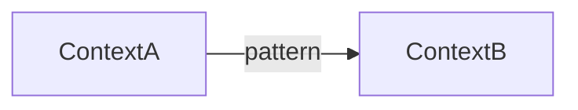

# Architecture Template

Use this structure. Omit sections that are genuinely irrelevant rather than filling them with filler. Prefer a lean spine of invariants over a comprehensive design encyclopedia. Skip Domain Landscape and a multi-context map when the altitude inherited one obvious context.

```markdown
# Architecture: [System / Feature Name]

**Status:** Draft | In Review | Final
**Altitude:** System | Feature | Epic/Slice
**Paradigm:** [e.g. modular monolith, hexagonal, event-driven]
**Author:** [name]
**Last updated:** [date]
**Sources:** [PRDs, specs, prior ADRs — links or paths]

## 1. Purpose & Scope

What this document governs, who it is for, and what it deliberately does not decide.

## 2. Design Paradigm

Named approach and the model it implies (boundaries, dependency direction, how work is packaged). One short paragraph plus the implication for implementers.

## 3. Context & Constraints

- Brownfield conventions to ratify (or "greenfield")
- Hard constraints (cloud, language, compliance, timeline, team skills)
- External systems and integration edges

```mermaid
C4Context or simple flowchart of system + actors + external deps
```

## 4. Ubiquitous Language

Inherit PRD wording. Flag conflicts; do not silently rename. One term per concept in this context.

| Term | Meaning in this system | Do not call it |
|------|------------------------|----------------|
| … | … | … |

## 5. Domain Landscape

Omit on small features with one obvious context. Label where design effort goes.

| Subdomain | Kind (core / supporting / generic) | Where effort goes |
|-----------|------------------------------------|-------------------|
| … | … | … |

## 6. Bounded Contexts & Context Map

At feature altitude, inherit existing contexts unless this slice creates a new language seam. Every edge needs a direction and a named pattern (Shared Kernel, Customer/Supplier, Conformist, Anticorruption Layer, Separate Ways, Open Host Service, Published Language, or Big Ball of Mud).

| Context | Owns | Language notes | Upstream / downstream | Integration pattern |
|---------|------|----------------|-----------------------|---------------------|
| … | … | … | … | … |



## 7. Architecture Decisions

### AD-1 — [Decision title]

- **Status:** Proposed | Adopted | Superseded by AD-n
- **Binds:** [capabilities, FR/NFR IDs, areas, or `all`]
- **Prevents:** [the incompatible choices this stops]
- **Rule:** [the constraint downstream must follow]
- **Alternatives considered:** [A vs B vs C — one line each]
- **Notes:** optional; keep short. Tag `[ASSUMPTION]` if unconfirmed.

### AD-2 — …

Decisions that only appear in a diagram still get an AD entry.

## 8. Consistency Conventions

Cross-cutting rules that are not full ADs but must stay consistent (naming, error shape, auth pattern, logging, ID strategy, API style, etc.).

| Convention | Rule |
|------------|------|
| … | … |

## 9. Stack & Versions

Pin only what must not drift. Verify versions before writing them.

| Component | Choice | Version | Notes |
|-----------|--------|---------|-------|
| Language / runtime | | | |
| Framework / starter | | | |
| Data store | | | |
| … | | | |

## 10. Structural Seed

Minimal shape to start from — owned by the codebase once it exists. Keep terse.

```text
{root}/
  {dir}/    # {what lives here}
```

Optional Mermaid for runtime/deployment view when helpful.

## 11. Data & State

- Ownership: who writes what
- Shared data and consistency expectations
- Key entities at this altitude (not a full schema dump)
- Aggregates (consistency boundaries): one transaction, one invariant set, referenced from outside by identity only
- Cross-aggregate consistency: how (event, process, outbox, same-transaction — which means they were not separate aggregates)
- Domain events: past-tense names from the language table; the contract between contexts

## 12. Quality Attributes

Only real, measurable constraints — omit dimensions with no requirement.

| Attribute | Requirement | Notes |
|-----------|-------------|-------|
| Performance | e.g. p95 … | |
| Availability | | |
| Security / privacy | | |
| Tenancy | | |
| Observability | | |
| Evolvability | What is expected to change; what is sacrificial; replacement trigger | |

## 13. Delivery & Operations

Environments, deploy model, config/secrets approach, migration/rollback posture — only what must be consistent across teams.

## 14. Deferred

What this altitude will not decide, and when to revisit.

| Item | Why deferred | Revisit when |
|------|--------------|--------------|
| … | … | … |

## 15. Open Questions & Assumptions

- **Open:** [question] — owner, needed by [when]
- **Assumed:** [assumption not yet confirmed] `[ASSUMPTION]`

## 16. Risks

| Risk | Impact | Mitigation |
|------|--------|------------|
| … | … | … |
```

## Writing guidance

- Fix **invariants**, not every implementation detail. If two implementers could choose differently without breaking consistency, or getting it wrong would be cheap to reverse, prefer Deferred.
- Internal quality is not traded for speed. Do not gold-plate: no speculative contexts, no language table nobody uses.
- Every `AD` must state what it **Binds**, what divergence it **Prevents**, and the **Rule** to follow.
- Keep `AD` IDs stable forever. Amend a Rule in place; add `AD-n` for new decisions; mark superseded rather than renumbering.
- Structural Seed is a cold-start aid, not a permanent map of the repo.
- Prefer diagrams for shape; prefer tables for decisions and pins.
- Requirements describe **what** (PRD); this doc describes **how we stay consistent** while building.
- Contexts before components. Language before internals.
